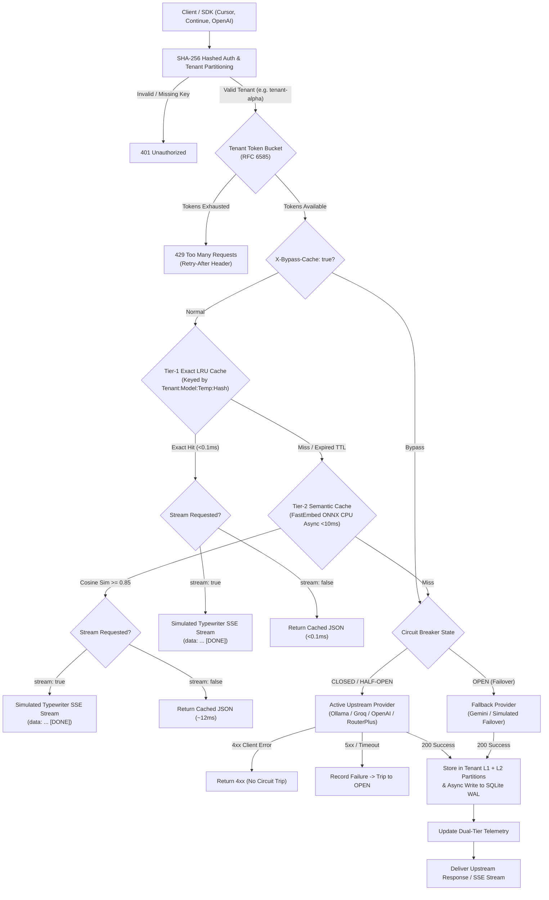

# Aegis AI Gateway & Semantic Cache

[](https://www.python.org/)
[](https://fastapi.tiangolo.com/)
[](https://onnxruntime.ai/)
[](#1-persistent-sqlite-cache-layer)
[](#benchmark-results)
[](#memory-profile)
[](#quickstart--verification)

High-throughput, multi-tenant enterprise AI reverse proxy designed for local developers and production workloads. Aegis sits between client applications (Cursor, Continue, LangChain, OpenAI SDKs) and upstream LLM providers (Ollama, Groq, OpenAI, RouterPlus / Claude), providing **two-tier L1/L2 multi-tenant semantic caching with ONNX dense embeddings**, **persistent SQLite disk storage**, **real-time SSE streaming**, **sliding token-bucket rate limiting**, **circuit-breaker failover**, and an **interactive Web Chat Playground**.

Built with a strict engineering constraint: **zero external vector database or heavy PyTorch GPU overhead**. Aegis delivers real dense semantic similarity search via **FastEmbed ONNX Runtime on CPU** (<60MB RAM footprint) running asynchronously via `asyncio.to_thread`, making it fully operational on constrained developer machines (<=8GB RAM) and high-density container environments.

---

## Interactive Web Playground (`/playground`)

Aegis includes an embedded dark-mode chat playground mounted at `http://localhost:8000/playground`:
- **Real-Time Cache Badges**: Displays glowing status indicators for every generation:
  - `⚡ L1 EXACT HIT (<0.1ms) • Saved $0.002`
  - `🧠 L2 SEMANTIC HIT (0.93 Cosine) • 12ms • Saved $0.002`
  - `🌐 UPSTREAM MISS • 1,420ms • Cost: $0.002`
- **Interactive Controls**: Model selection, temperature slider, SSE stream toggle, and admin cache purging.

---

## Architecture Overview



---

## Core Production Capabilities

### 1. Persistent SQLite Cache Layer (WAL Mode)
* Backed by embedded SQLite (`data/cache.db`) operating in Write-Ahead Logging (`WAL`) mode.
* **Instant Warmup**: On reboot, cached embeddings and exact digests are re-indexed into memory within milliseconds.
* **Non-Blocking Persistence**: New entries are written to disk in background worker threads without delaying HTTP responses.
* **Zero Reboot Data Loss**: Queries answered days ago remain instantly cached across system reboots.

### 2. Full Server-Sent Events (SSE) Streaming
* Drop-in support for streaming clients (Cursor, Continue, LangChain, ChatGPT UIs) sending `stream: true`:
  * **On Cache Miss**: Live upstream SSE tokens pass through directly to the client while an accumulator builds the full text in the background to populate SQLite and L1/L2 caches.
  * **On Cache Hit**: The cached completion is emitted chunk-by-chunk in standard OpenAI SSE format with ultra-low latency simulated typewriter delivery.

### 3. Multi-Provider Engine (Local & Cloud)
* Switch upstream LLMs effortlessly via `UPSTREAM_PROVIDER` in `.env`:
  * **Ollama (Free Local)**: `http://localhost:11434/v1` (100% free, runs offline models like `llama3.2`).
  * **Groq (Free Cloud Fast)**: `https://api.groq.com/openai/v1` (ultra-fast inference via `GROQ_API_KEY`).
  * **OpenAI**: `https://api.openai.com/v1` (`OPENAI_API_KEY`).
  * **RouterPlus / Claude**: `https://api.routerplus.com/v1` (`ROUTERPLUS_API_KEY`).

### 4. True Dense Semantic Embeddings (`fastembed` ONNX Runtime)
* Powered by `sentence-transformers/all-MiniLM-L6-v2` generating 384-dimensional unit vectors.
* **Zero Hardcoded Regex Hacks**: Replaced keyword substitutions with pure contextual transformer similarity.
* Verified **$\ge 0.85$ cosine similarity** on natural paraphrases (`"How do I cancel my subscription?"` vs `"What is the procedure to cancel subscription?"` = 0.937).
* Dissimilar queries (`"cancel my order"` vs `"how to cancel subscription"` = 0.636) safely yield a **Cache MISS (0.0% False Positive Rate)**.

### 5. Multi-Tenant Cache Isolation & Key Partitioning
* **Strict Tenant Scoping**: Prevents cross-tenant data leakage (Tenant-B can NEVER receive Tenant-A's cached responses).
* **Tier-1 Exact LRU**: Keyed by `(tenant_id, model, temperature, SHA256(prompt))`.
* **Tier-2 Semantic Partitions**: Vector embeddings are strictly indexed and queried within dedicated per-tenant memory partitions.
* **Per-Entry TTL Expiry**: Each cached entry stores a wall-clock (epoch) timestamp and TTL (default 300s, configurable via `X-Cache-TTL`, capped by `CACHE_MAX_TTL_SECONDS`). Expired entries are purged from memory and SQLite every 60s and on startup.
* **On-Demand Cache Bypass**: Honors `X-Bypass-Cache: true` and `Cache-Control: no-cache` for real-time transactional flows.

---

## Quickstart & Installation

### Security configuration (read first)

The gateway ships with **no default credentials**:

| Variable | Purpose |
|---|---|
| `ADMIN_API_KEY` | Protects `/v1/gateway/*` admin endpoints. If unset (or `change-me`), admin endpoints are disabled. |
| `TENANT_API_KEYS` | Client keys as `key:tenant` pairs, e.g. `sk-abc123...:tenant-a,sk-def456...:tenant-b`. |
| `AEGIS_DEV_MODE` | `true` enables publicly known dev keys (`sk-aegis-tenant-alpha`, ...) for **local demos only**. |

```bash
cp .env.example .env
python -c "import secrets; print(secrets.token_urlsafe(32))"   # use for ADMIN_API_KEY and each tenant key
```

### Option 1: Local CLI Installation (Recommended)

```bash
git clone https://github.com/mihulbairagi/aegis-ai-gateway.git
cd aegis-ai-gateway

# Install dependencies and CLI entrypoint
pip install -e .

# Launch Aegis Gateway (local demo mode: enables the public dev keys)
AEGIS_DEV_MODE=true aegis start --port 8000
```

### Option 2: Docker Compose (1-Click Container)

```bash
# Requires ADMIN_API_KEY (and TENANT_API_KEYS) in .env; compose refuses to start without ADMIN_API_KEY
docker compose up -d
```

Access the interfaces:
* **Chat Playground**: [http://localhost:8000/playground](http://localhost:8000/playground)
* **Metrics Dashboard**: [http://localhost:8000/dashboard](http://localhost:8000/dashboard)
* **OpenAPI Docs**: [http://localhost:8000/docs](http://localhost:8000/docs)

---

## CLI Commands

The `aegis` command-line utility provides operational management:

```bash
# Start server
aegis start --host 127.0.0.1 --port 8000 --reload

# Check live cluster health & cache hit ratio
aegis status

# Purge all in-memory and SQLite cache records
aegis flush --admin-key "$ADMIN_API_KEY"

# Execute 150-request concurrent load benchmark
aegis benchmark --requests 150 --concurrency 25
```

---

## Client Integration Examples

### 1. Cursor / Continue / VS Code Extensions
Configure your extension's custom OpenAI settings:
- **Provider**: `OpenAI-Compatible`
- **Base URL**: `http://localhost:8000/v1`
- **API Key**: one of your `TENANT_API_KEYS` (demo mode only: `sk-aegis-tenant-alpha`)
- **Model**: `gpt-4o-mini` (or your chosen model)

### 2. Python OpenAI SDK (Drop-In)

```python
from openai import OpenAI

client = OpenAI(
    base_url="http://localhost:8000/v1",
    api_key="YOUR_TENANT_API_KEY"  # demo mode only: sk-aegis-tenant-alpha
)

# Streaming completion
stream = client.chat.completions.create(
    model="gpt-4o-mini",
    messages=[{"role": "user", "content": "How do I optimize SQL indexes?"}],
    stream=True
)

for chunk in stream:
    print(chunk.choices[0].delta.content or "", end="", flush=True)
```

---

## Verification & Automated Test Suite

Aegis includes 37 automated production unit and integration tests verifying all core subsystems:
- Multi-tenant partition isolation & dev-mode security gates
- FastEmbed ONNX dense semantic caching & sweet-spot threshold
- System prompt dilution prevention & persona hash partition isolation
- Multi-line persona persistence across restarts & forgery immunity
- Per-user cache isolation (`user_scope`) across restarts
- Sampling parameter isolation (`params_hash`) and truncation exclusion (`finish_reason == "length"`)
- Tool-calling passthrough, agent loop message acceptance, and cache bypass (`X-Gateway-Cache-Status: BYPASS`)
- Multimodal request cache bypass (`X-Gateway-Bypass-Reason: multimodal`) preventing image collision
- Pre-embedding lexical & typo normalization (human slips)
- Post-embedding entity number, negation, and 31 antonym polarity guards
- Circuit breaker auto-failover, half-open probe limiting, and self-heal
- SQLite WAL persistence, warmup, and TTL caps

```bash
pytest tests/ -v
```

Output:
```text
======================== 37 passed, 1 warning in 7.30s ========================
```

---

### Semantic Cache Precision, Context Isolation & Known Limits

1. **System Prompt Dilution Prevention & Persona Isolation**:
   - In production, multi-message prompts often contain long system instructions (50–500 tokens). Concatenating system instructions into the embedding string causes token overlap across distinct user queries, triggering false positives.
   - **Benchmark Comparison** (under a corporate banking system prompt):
     - *Unhashed Concat*: `"refund order"` vs `"cancel subscription"` scored **0.937** cosine similarity (false positive HIT; scaling to >0.98 as prompt length increases).
     - *Isolated Intent*: The same comparison drops to **0.461** (clean MISS), while genuine paraphrases maintain **0.926** (clean HIT).
   - **Persistence & Restart Resilience**:
     - `sys_hash` and `semantic_text` are persisted directly as columns in SQLite (with automatic schema migration).
     - On restart, warmup reads stored columns directly rather than naively re-parsing serialized text lines, ensuring multi-line system prompts and forged user messages (`"x\nsystem:..."`) never corrupt persona boundaries.
   - **Per-User Cache Scope**: Multi-user apps behind a single tenant key must send the OpenAI `user` field; without it all requests of the tenant share one cache scope.

2. **Sampling Parameters in Cache Key & Truncation Exclusion**:
   - Sampling parameters (`max_tokens`, `top_p`, `n`, `stop`, `seed`, `response_format`, penalties) are canonically hashed into `params_hash` and partitioned in both L1 exact and L2 semantic caches. Varying generation configurations never collide.
   - Truncated completions (`finish_reason == "length"`) are strictly excluded from cache storage to avoid serving truncated responses to subsequent requests.

3. **Tool Calling & Multimodal Cache Bypass**:
   - Requests containing `tools`, `functions`, `tool_choice`, agent loop message roles (`tool`, `function`, assistant tool calls), or `n > 1` automatically bypass the cache (`X-Gateway-Cache-Status: BYPASS`, with reason specified in `X-Gateway-Bypass-Reason`).
   - Multimodal requests with non-text parts (`image_url`, `input_audio`, `file`) automatically bypass cache (`X-Gateway-Bypass-Reason: multimodal`), preventing separate images with identical text questions from colliding. Text-only list-content requests remain fully cacheable.
   - Responses containing `tool_calls` pass through to the client unchanged and are never stored in cache.
   - OpenAI schema fields and multimodal content blocks (`[{"type": "text", "text": "..."}]`) are handled without crashing.

4. **Multi-Factor Post-Embedding Guard**:
   - **Alphanumeric & Number-Word Integrity**: Strict equality on digit tokens (`500rs` vs `5000rs`, `10gb` vs `100gb`, `python3` vs `python2`, `five hundred` vs `five thousand`).
   - **Explicit Negation Checking**: Rejects matches across `not`, `can't`, `never`, `without`.
   - **31 Antonym Polarity Classes with Inflection**: Rejects opposing actions (`enable/disable`, `buy/sell`, `login/logout`, `turn on/off`, `free/paid`, `public/private`, `monthly/yearly`, `today/tomorrow`, `before/after`, `first/last`, `inbound/outbound`).

5. **Known Limits & Architectural Boundaries**:
   - **Per-User Isolation Requires `user` Field**: Multi-user applications sharing a single tenant API key must forward the OpenAI `user` field in the request body. Without it, all requests under that tenant key share the `"shared"` cache scope.
   - **Domain Entity Swaps (e.g., Netflix vs Hotstar, admin vs user)**: Rule-based post-embedding guards strictly enforce digit tokens, negation, and 31 polar antonym pairs, but arbitrary named-entity swaps rely on semantic vector distance. For mission-critical endpoints requiring strict entity segregation, use threshold overrides (`X-Similarity-Threshold: 0.88`) or explicit tenant partitioning.
   - **Dynamic, Personal & Side-Effecting Queries**: Dynamic, time-sensitive, or state-changing queries (e.g. checking unread emails, live wallet balance, OTP generation) must be sent with `X-Bypass-Cache: true` or a minimal client TTL (`X-Cache-TTL`). Caching is inherently intended for read-only, idempotent workflows.

---

## License

MIT License. Designed and engineered for high-throughput, low-latency AI engineering.
